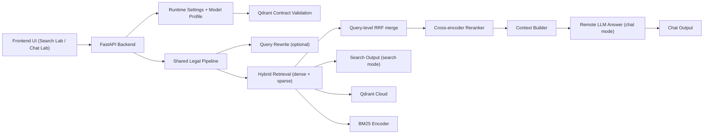

# Legal Pipeline Current State

Updated: `2026-03-14`

## 1. Muc dich tai lieu

Tai lieu nay mo ta trang thai hien tai cua he thong legal retrieval/demo sau khi da:

- chuyen sang `shared legal pipeline`
- index lai Qdrant cloud moi bang `truro7/vn-law-embedding`
- doi chunking sang `Dieu-first`
- tich hop `query rewrite`
- tich hop frontend/backend de demo voi `2 model` va `2 query mode`

Tai lieu nay tra loi 6 cau hoi:

1. He thong dang o trang thai nao.
2. Du lieu nao da len Qdrant.
3. Chunking dang tao ra chunk nhu the nao.
4. LLM/embedding/reranker dang duoc dung o dau.
5. Pipeline search/chat chay theo thu tu nao.
6. Input, output, context va artifact dang duoc quan ly ra sao.

## 2. Snapshot hien tai

### 2.1 Trang thai he thong

- Frontend demo chinh: React app trong `web_app/frontend`
- Backend demo chinh: FastAPI trong `web_app/backend/main.py`
- Backend mode dang duoc smoke test: `shared_legal_pipeline`
- Qdrant cloud target: `AWS us-east-1-1`
- Collection retrieval chinh:
  - `legal_documents__truro7_vn_law_embedding__d768`

### 2.2 Snapshot data da index

- Nguon dataset:
  - `data/gold/vbpl_gold.parquet`
- Scope index hien tai:
  - `source_set=primary`
  - `1255` van ban
- So points dang phuc vu tren collection chinh:
  - `57551`
- Vector space:
  - dense embedding dim `768`
  - sparse vector BM25 tren cung tap chunk

### 2.3 Snapshot smoke gan nhat

Artifact:

- `data/gold/research/index_runs/run_20260314_backend_frontend_smoke10_v2/backend_frontend_smoke10.json`
- `data/gold/research/index_runs/run_20260314_backend_frontend_smoke10_v2/backend_frontend_smoke10.md`

Ket qua:

- `10/10` query search HTTP `200`
- `10/10` query co top-1 `citation_full` khong rong
- `10/10` query co it nhat `3` ket qua
- `matrix_ok=4`
- frontend va backend deu ok

Nhan dinh chat luong:

- integration da thong
- routing model/query mode da hoat dong
- nhung relevance retrieval hien van chua tot
- nhieu query top-1 van lech van ban dich

Ket luan thang:

- he thong da `demoable` ve mat ky thuat
- he thong chua `demo-grade` ve mat chinh xac retrieval

## 3. Kien truc tong the

## 3.1 Thanh phan chinh

### Frontend

- file shell chinh:
  - `web_app/frontend/src/App.jsx`
- legal UI moi:
  - `web_app/frontend/src/components/LegalLabArea.jsx`
- hai tab:
  - `Search Lab`
  - `Chat Lab`

### Backend

- entrypoint:
  - `web_app/backend/main.py`
- backend van giu cac path cu cho user docs/OCR/dashboard
- shared runtime moi duoc bat boi flag:
  - `BACKEND_USE_SHARED_LEGAL_PIPELINE=true`
- khi bat flag, `search_mode=legal|user|hybrid` deu di qua shared orchestration
- retrieval cho `search_mode=user|hybrid` mac dinh la user-wide theo `user_id`
- `session_id` van duoc giu cho upload lineage/history/status/artifact/debug, nhung khong con la default retrieval filter

### Shared runtime/pipeline

- runtime settings:
  - `src/config/runtime_settings.py`
- qdrant contract:
  - `src/runtime/qdrant_contract.py`
- pipeline factory:
  - `src/factories/legal_pipeline_factory.py`
- main orchestration:
  - `src/legal_rag_pipeline.py`
- backend adapter:
  - `src/adapters/backend_adapter.py`

### Retrieval/Index layer

- chunking:
  - `src/legal_chunker_v2.py`
- qdrant store:
  - `src/qdrant_store.py`
- upload/index script:
  - `scripts/upload_qdrant_cloud_embeddings.py`

### LLM services

- model profile registry:
  - `src/services/model_profile_registry.py`
- remote answer client:
  - `src/services/remote_llm_client.py`
- query rewrite service:
  - `src/services/query_rewrite_service.py`
- low-level rewriter:
  - `src/legal_query_rewriter.py`

### Reranker

- reranker:
  - `src/reranker.py`
- current reranker model:
  - `AITeamVN/Vietnamese_Reranker`

## 3.2 Kien truc logic



## 4. Du lieu dua vao he thong

## 4.1 Nguon raw/gold

He thong retrieval hien tai dang dung nguon:

- `data/gold/vbpl_gold.parquet`

Truong metadata chinh trong row van ban:

- `so_ky_hieu`
- `van_ban_id`
- `ten_van_ban`
- `loai_van_ban`
- `co_quan_ban_hanh`
- `nguoi_ky`
- `ngay_ban_hanh`
- `ngay_co_hieu_luc`
- `ngay_het_hieu_luc`
- `full_text`/legal text

Truoc khi chunking, row duoc chuan hoa boi logic trong:

- `src/legal_data_processing.py`

Muc dich:

- clean `ten_van_ban`
- sinh `law_family`
- sinh `citation_base`
- chuan hoa metadata de len Qdrant khong con title ban

## 4.2 Du lieu da len Qdrant

Collection hien tai:

- `legal_documents__truro7_vn_law_embedding__d768`

Moi point tren Qdrant gom:

- `dense` vector tu embedding model
- `sparse` vector tu BM25
- `payload` lean metadata

Payload cốt lõi:

- `chunk_id`
- `content`
- `doc_id`
- `so_ky_hieu`
- `ten_van_ban`
- `law_family`
- `doc_type`
- `co_quan_ban_hanh`
- `nguoi_ky`
- `ngay_ban_hanh`
- `ngay_co_hieu_luc`
- `is_active`
- `status_label`
- `dieu_so`
- `tieu_de_dieu`
- `legal_path`
- `chunk_type`
- `segment_level`
- `provision_id`
- `citation_base`
- `citation_full`
- `token_len_model`
- `overflow_index`
- `overflow_total`
- `clause_spans`
- `encoder_profile`

Y nghia:

- Retrieval doc-level cua he thong thuc chat dang la retrieval tren `Dieu` hoac `article_window`
- Citation/trace duoc phuc vu tu payload nay

## 5. Chunking dang hoat dong nhu the nao

## 5.1 Chinh sach chunking hien tai

Chunking production da khoa sang:

- `Dieu-first`
- `Khoan/Diem` khong con la primary boundary
- Production retrieval chi index `ProvisionChunk`

File logic:

- `src/legal_chunker_v2.py`

## 5.2 Rule chia chunk

### Boundary chinh

- Neu mot `Dieu` nam trong budget tokenizer cua model embedding:
  - tao `1` chunk
  - `segment_level=article`

- Neu mot `Dieu` vuot budget:
  - tach ben trong chinh `Dieu` do
  - tao nhieu `article_window`
  - `segment_level=article_window`
  - khong cross sang `Dieu` khac

### Budget hien tai

- `encoder_max_len = 512`
- `target_chunk_tokens = 420`
- `hard_cap_tokens = 448`
- `overlap_tokens = 64`

### Rule bao ve parser

Chunker da fix loi `Khoan 000` bang cach:

- khong coi moi mau `123.` la boundary hop le
- bao ve so tien/sinh so nhu:
  - `100.000`
  - `1.500.000.000`
  - `30.000.000`
- chi chap nhan marker dieu that su nhu:
  - `Dieu X.`
  - `Dieu X:`

### Metadata clause

`Khoan/Diem` van duoc giu, nhung chi o dang metadata:

- `clause_spans`

Vi du:

- `Khoan 1-2`
- `Khoan 1-4`

## 5.3 Vi sao so chunk giam manh

Collection cu clause-heavy co the len toi `155,938` points.

Collection hien tai chi con `57,551` points vi:

- da bo clause-level retrieval
- da index chu yeu theo `Dieu`
- chi split khi `Dieu` qua dai

Trade-off da chot:

- tang context coherence
- giam noise parse clause
- de doi tuong citation on dinh hon
- chap nhan co the giam recall o mot so query rat specific theo clause

## 6. Model nao dang duoc dung, dung o dau

## 6.1 Embedding model

Embedding retrieval hien tai:

- model: `truro7/vn-law-embedding`
- vector dim: `768`
- normalize: `true`

No duoc dung o 2 noi:

1. Luc index chunks len Qdrant
2. Luc embed query de retrieval

Luu y quan trong:

- selector `Model Luat / Qwen3 8B` tren UI KHONG doi embedding retrieval
- retrieval embedding hien tai van khoa o `truro7/vn-law-embedding`

## 6.2 Reranker model

Reranker hien tai:

- `AITeamVN/Vietnamese_Reranker`

Vai tro:

- nhan shortlist sau hybrid retrieval
- score lai de sap xep top-k cuoi cung
- duoc bat trong legal demo path

## 6.3 LLM answer/rewrite providers

UI hien tai co 2 profile:

### 1. `legal_tgi_remote`

- label UI: `Model Luat`
- provider type: `tgi_completions`
- endpoint mac dinh:
  - `http://222.255.250.24:8080/v1/completions`
- model mac dinh:
  - `tgi`

### 2. `qwen3_8b_ollama_remote`

- label UI: `Qwen3 8B`
- provider type: `ollama_generate`
- endpoint mac dinh:
  - `http://222.255.250.24:11434/api/generate`
- model:
  - `qwen3:8b`

## 6.4 Quy tac dung model trong UI

Model duoc chon trong UI se chi phoi:

- rewrite query neu `query_mode = rewrite_combine`
- answer generation neu `labTab = Chat Lab`

Model duoc chon KHONG chi phoi:

- embedding retrieval
- qdrant collection
- BM25 encoder

## 7. Query mode va y nghia

UI hien co 2 query mode:

## 7.1 `Original Query`

- khong rewrite
- retrieval dung cau hoi goc
- neu o `Chat Lab`, sau retrieval se dung model da chon de sinh cau tra loi

## 7.2 `Rewrite + Combine`

- model duoc chon rewrite query thanh cac sub-query
- he thong luon giu lai query goc
- retrieval chay tren:
  - `rewritten subqueries`
  - `original query`
- ket qua cac ranking se duoc hop nhat bang `query-level RRF`
- neu o `Chat Lab`, model do tiep tuc sinh answer tu context sau retrieval

## 8. Pipeline search/chat dang chay nhu the nao

## 8.1 Search Lab (`/api/search`)

Trinh tu:

1. Frontend gui request toi backend.
2. Backend xac dinh:
   - `model_profile_id`
   - `query_mode`
   - `top_k`
   - `require_active_only`
3. Backend tao `QueryRewriteService` tu model da chon.
4. Backend lay `RuntimeSettings`.
5. Backend validate Qdrant contract:
   - dung cloud
   - dung collection
   - dung embedding profile
   - collection co the query
6. Backend lay singleton pipeline tu factory.
7. Pipeline goi `_retrieve()`:
   - rewrite neu can
   - classify intent
   - embed query bang `truro7`
   - hybrid search dense + sparse
   - merge ket qua cac subquery bang RRF
   - rerank bang Vietnamese reranker
8. Backend format sources va trace.
9. Frontend hien search cards + rewrite trace.

## 8.2 Chat Lab (`/api/chat`)

Trinh tu:

1. Giai doan retrieval giong `Search Lab`.
2. Pipeline build `context` tu top results.
3. Backend tao `RemoteLLMClient` tu `model_profile_id`.
4. LLM duoc chon sinh answer tu:
   - `question`
   - `context`
   - `system prompt`
5. Backend tra ve:
   - `answer`
   - `sources`
   - `timing`
   - `rewrite trace`
   - `fallback status`

Neu provider loi:

- backend fallback ve retrieval-only
- van tra citation
- khong lam crash endpoint

## 8.3 Context build cho LLM

Context khong phai raw JSON. Context duoc build thanh van ban co cau truc trong:

- `src/legal_rag_pipeline.py::_format_context`

Format:

```text
[1] <citation_full>
<chunk content>

---

[2] <citation_full>
<chunk content>
```

Moi block context duoc tao tu:

- `citation_full` neu co
- neu khong thi fallback bang:
  - `loai_van_ban`
  - `ten_van_ban`
  - `Dieu/Khoan/Diem`

Phan `content` duoc dua nguyen van chunk content sau khi chunking.

## 8.4 System prompt/answer prompt

Answer prompt mac dinh:

```text
CONTEXT:
<context>

CAU HOI: <query>

TRA LOI:
```

System prompt mac dinh yeu cau:

- chi tra loi dua tren context da cung cap
- neu khong du thong tin thi phai noi ro khong tim thay quy dinh lien quan

## 9. Request/response hien tai

## 9.1 `POST /api/search`

Input quan trong:

- `query`
- `search_mode`
- `top_k`
- `use_reranker`
- `model_profile_id`
- `query_mode`
- `require_active_only`

Output quan trong:

- `results[]`
- `search_time`
- `rerank_time`
- `reranker_used`
- `model_profile_id`
- `query_mode`
- `rewrite_used`
- `rewrite_status`
- `rewrite_fallback_reason`
- `rewritten_queries`
- `per_subquery_hits`
- `retrieval_union_count`
- `collection`

## 9.2 `POST /api/chat`

Input quan trong:

- `message`
- `search_mode`
- `top_k`
- `use_reranker`
- `model_profile_id`
- `query_mode`
- `response_mode`
- `require_active_only`
- `use_graph`

Output quan trong:

- `answer`
- `sources[]`
- `search_time`
- `generation_time`
- `total_time`
- `rerank_time`
- `reranker_used`
- `model_profile_id`
- `query_mode`
- `rewrite_used`
- `rewrite_status`
- `rewritten_queries`
- `per_subquery_hits`
- `retrieval_union_count`
- `fallback_used`
- `fallback_error`
- `collection`

## 10. Frontend dang hoat dong nhu the nao

File UI chinh:

- `web_app/frontend/src/components/LegalLabArea.jsx`

Trang legal hien tai co:

- `Search Lab`
  - de debug retrieval nhanh
  - khong goi answer LLM
- `Chat Lab`
  - goi retrieval roi moi goi answer model

Thanh control chung:

- chon `Model Luat` / `Qwen3 8B`
- chon `Original Query` / `Rewrite + Combine`
- `Top K`
- `Active only`

Trang thai luu trong `localStorage`:

- model da chon
- query mode
- tab hien tai
- active only
- top_k

## 11. Observability va artifact

## 11.1 Runbook va progress log

- demo runbook:
  - `docs/CHAINLIT_HYBRID_DEMO_RUNBOOK.md`
- progress log:
  - `data/gold/research/embedding_graph_execution_progress_v3.md`

## 11.2 Artifact quan trong nen theo doi

### Backend/frontend smoke 10 query

- `data/gold/research/index_runs/run_20260314_backend_frontend_smoke10_v2/backend_frontend_smoke10.json`
- `data/gold/research/index_runs/run_20260314_backend_frontend_smoke10_v2/backend_frontend_smoke10.md`

### Qdrant/chunking guide

- `docs/plan/requery_qdrant_refactor_v1/08_qdrant_data_and_chunking_guide.md`

### Chainlit/requery plan

- `docs/plan/requery_qdrant_refactor_v1/01_chainlit_requery_qdrant_plan.md`

## 11.3 Status API

Backend co cac endpoint status quan trong:

- `GET /api/status`
- `GET /api/settings/model-profiles`

Dung de check:

- backend dang o mode nao
- collection nao dang phuc vu
- model profiles nao dang bat
- shared pipeline co dang duoc su dung khong

## 12. Gioi han va van de hien tai

## 12.1 Van de da giai quyet

- da fix title ban trong payload
- da fix `Khoan 000`
- da chuyen sang article-first chunking
- da tach provider selector cho `Model Luat` va `Qwen3 8B`
- da tich hop rewrite + answer theo model da chon

## 12.2 Van de chua giai quyet

- retrieval relevance hien tai van yeu
- top-1 cua nhieu query van lech luat dich
- graph context hien dang ngoai scope demo mac dinh
- collection hien tai query duoc, nhung ranking chua dat muc strong demo

## 12.3 Dieu khong nen nham

- UI model selector khong doi embedding retrieval
- `Rewrite + Combine` khong phai rewrite-only
- backend van con path cu cho OCR/dashboard va cac route chua refactor, nhung chat/search shared runtime da phuc vu ca `legal|user|hybrid` khi bat feature flag

## 13. Du lieu vao/ra tong hop

## 13.1 Input cua pipeline

Pipeline nhan 4 nhom input:

### A. User query

- cau hoi nguoi dung
- query mode
- top_k

### B. Runtime profile

- qdrant url/key
- collection base
- embedding model retrieval
- reranker settings
- rewrite settings

### C. Model profile

- provider type
- endpoint
- model
- timeout

### D. Indexed corpus

- cac chunk da len Qdrant
- BM25 encoder cache

## 13.2 Output cua pipeline

Search mode tra:

- ranked legal chunks
- citation metadata
- rewrite trace
- timing

Chat mode tra them:

- answer text
- fallback state neu provider loi

## 14. Luong hoat dong ngan gon

### Search Lab

`query -> optional rewrite -> hybrid retrieval -> RRF -> rerank -> source cards`

### Chat Lab

`query -> optional rewrite -> hybrid retrieval -> RRF -> rerank -> context build -> answer LLM -> sources + trace`

## 15. Ket luan hien tai

Trang thai hien tai cua he thong la:

- pipeline va UI/backend da noi thong
- Qdrant cloud moi da phuc vu collection article-first
- requery da co trong he thong va co feature flag/query mode ro rang
- chat/search da co trace va artifact de debug
- nhung bai toan tiep theo khong con la wiring nua
- bai toan tiep theo la:
  - tuning retrieval
  - kiem soat ranking drift
  - benchmark chat luong tren bo query phap ly co nhan
