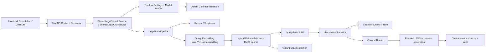
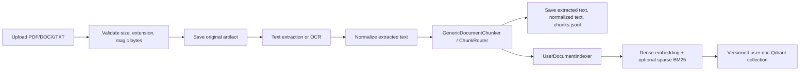
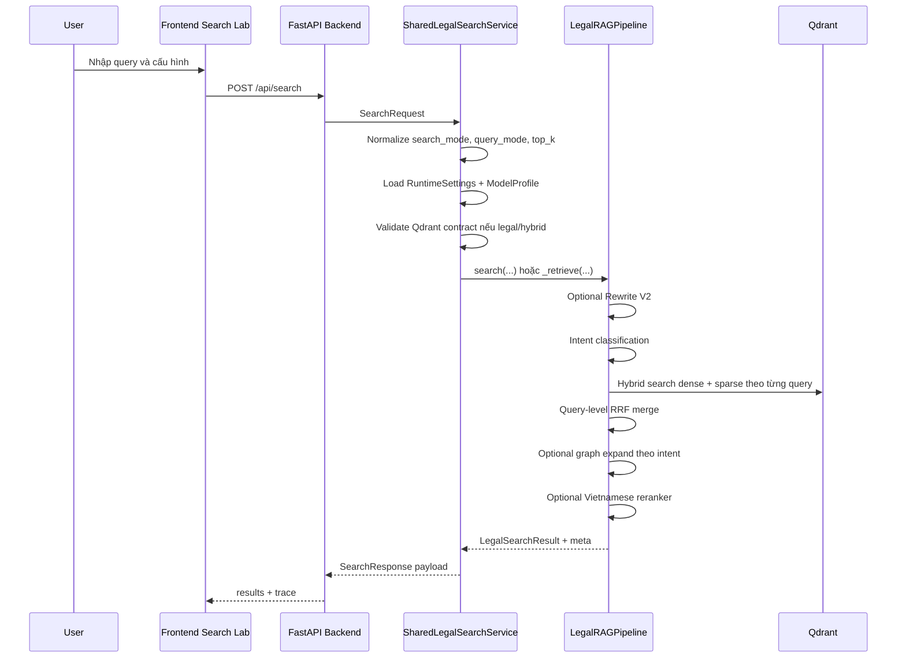
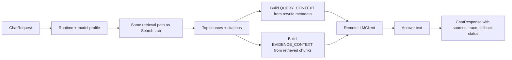

# Báo cáo dữ liệu và pipeline RAG của hệ thống Vietnamese Legal RAG

Updated: `2026-05-08`

## 1. Tóm tắt

Hệ thống là một demo Retrieval-Augmented Generation (RAG) cho truy vấn pháp lý tiếng Việt. Mục tiêu chính là giúp người dùng tra cứu văn bản pháp luật, kiểm tra nguồn trích dẫn, và sinh câu trả lời có căn cứ từ các đoạn văn bản được truy hồi.

Trạng thái hiện tại của hệ thống tập trung vào đường chạy shared legal runtime:

- Backend chính: FastAPI trong `web_app/backend`.
- Frontend chính: React/Vite trong `web_app/frontend`.
- Core runtime: các module trong `src`.
- Feature flag bắt buộc cho đường chạy hiện tại: `BACKEND_USE_SHARED_LEGAL_PIPELINE=true`.
- Embedding retrieval cố định: `truro7/vn-law-embedding`.
- Vector dimension: `768`.
- Collection pháp luật chính: `legal_documents__truro7_vn_law_embedding__d768`.
- Retrieval: dense vector + BM25 sparse vector, hợp nhất bằng query-level RRF.
- Reranker: `AITeamVN/Vietnamese_Reranker`.
- Rewrite: Rewrite V2, dùng LLM như bộ trích xuất khách quan, không phải paraphrase tự do.

Báo cáo này mô tả hệ thống theo hướng dữ liệu đi qua pipeline: dữ liệu đầu vào, xử lý dữ liệu, indexing, retrieval, rewrite, rerank, answer generation, API contract, trace/debug, frontend hiển thị, hạn chế hiện tại và hướng cải thiện.

## 2. Nguồn tài liệu và phạm vi

Nguồn chính để tổng hợp báo cáo là các live docs và code path hiện tại:

- `README.md`
- `docs/LEGAL_SYSTEM_OVERVIEW.md`
- `docs/LEGAL_PIPELINE_CURRENT_STATE.md`
- `docs/LEGAL_REWRITE_V2.md`
- `docs/BACKEND_ARCHITECTURE_MAINTENANCE.md`
- `docs/PROJECT_CODE_REPORT.md`
- `src/legal_rag/pipeline/orchestrator.py`
- `web_app/backend/services/shared_legal_services.py`
- `src/adapters/backend_adapter.py`
- `web_app/backend/api/schemas.py`
- `src/legal_chunker_v2.py`
- `src/document_ingestion/*`
- `src/legal_rag/stores/qdrant/*`

Phạm vi báo cáo:

- Mô tả trạng thái hệ thống hiện tại, không đề xuất thay đổi public API.
- Bám theo shared runtime hiện tại, không coi các đường demo Chainlit/legacy là production path.
- Không dùng `docs/archive` làm nguồn chính, chỉ xem đó là tài liệu lịch sử.
- Không thiết kế lại pipeline, chỉ hệ thống hóa pipeline đang tồn tại.

## 3. Mục tiêu hệ thống

Hệ thống được xây dựng để giải quyết hai nhóm nhu cầu:

1. Tra cứu và debug retrieval pháp luật tiếng Việt.
2. Sinh câu trả lời pháp lý có căn cứ, có nguồn và có trace.

Frontend chia rõ hai chế độ:

- `Search Lab`: dùng để kiểm tra retrieval, citation, rewrite trace và chất lượng source cards. Chế độ này không sinh câu trả lời bằng LLM.
- `Chat Lab`: dùng cùng pipeline retrieval, sau đó build context và gọi LLM để sinh câu trả lời.

Mục tiêu kỹ thuật hiện tại:

- Đảm bảo wiring frontend/backend/core runtime ổn định.
- Giữ trace rõ ràng cho rewrite, retrieval, rerank và answer generation.
- Giữ citation xuyên suốt pipeline.
- Tránh hallucination bằng cách buộc answer dựa trên evidence context.
- Fallback an toàn khi provider rewrite/answer bị lỗi.

## 4. Kiến trúc tổng quan

Hệ thống được chia thành bốn lớp:

| Lớp | Thành phần | Vai trò |
|:---|:---|:---|
| UI layer | `web_app/frontend` | Nhận query, cấu hình model/query mode/top_k, hiển thị kết quả và trace |
| API layer | `web_app/backend/api`, `web_app/backend/main.py` | Nhận request FastAPI, validate schema, route vào service |
| Application/service layer | `web_app/backend/services`, `src/services`, `src/adapters` | Chuẩn bị runtime, gọi pipeline, merge legal/user results, format payload |
| Domain/runtime layer | `src/legal_rag`, `src/legal_rag_pipeline.py`, `src/qdrant_store.py` | Rewrite, retrieval, RRF, rerank, context build, answer generation |

Sơ đồ logic:



## 5. Dữ liệu đầu vào

### 5.1 Dữ liệu pháp luật chuẩn

Nguồn dữ liệu pháp luật chính hiện tại là:

- `data/gold/vbpl_gold.parquet`

Theo snapshot hiện tại:

- Scope index: `source_set=primary`.
- Số văn bản: `1255`.
- Số points trong collection chính: `57551`.
- Vector space: dense embedding dim `768` và sparse BM25 trên cùng tập chunk.

Mỗi dòng văn bản pháp luật chứa các metadata cốt lõi:

- `so_ky_hieu`
- `van_ban_id`
- `ten_van_ban`
- `loai_van_ban`
- `co_quan_ban_hanh`
- `nguoi_ky`
- `ngay_ban_hanh`
- `ngay_co_hieu_luc`
- `ngay_het_hieu_luc`
- `full_text` hoặc legal text tương đương

Trước khi chunking, dữ liệu được chuẩn hóa bằng logic trong `src/legal_data_processing.py`. Mục tiêu là làm sạch tên văn bản, chuẩn hóa doc id, sinh `law_family`, sinh `citation_base`, sinh `citation_full`, và đưa metadata về dạng ổn định để phục vụ retrieval/citation.

### 5.2 Dữ liệu upload người dùng

Ngoài corpus pháp luật dùng chung, hệ thống hỗ trợ người dùng upload tài liệu riêng. Đường xử lý này nằm trong:

- `web_app/backend/document_ingestion_service.py`
- `src/document_ingestion/service.py`
- `src/document_ingestion/chunking.py`
- `src/document_ingestion/indexer.py`
- `src/document_ingestion/storage.py`

Định dạng file upload được hỗ trợ:

- PDF
- DOCX
- TXT

Hệ thống kiểm tra:

- File rỗng.
- Kích thước vượt giới hạn.
- Extension không hỗ trợ.
- Magic bytes của PDF/DOCX/TXT.
- `.doc` cũ không được hỗ trợ trong V1.

Mỗi upload có các định danh:

- `user_id`: phân vùng dữ liệu theo người dùng.
- `session_id`: lưu lineage, history, status, artifact và debug metadata.
- `doc_id`: định danh tài liệu upload.
- `job_id`: định danh job ingestion bất đồng bộ.

Artifact upload được lưu theo cấu trúc user/session/document trong `data/uploads/`, gồm file gốc, text trích xuất, normalized text, chunks JSONL và các artifact debug nếu có.

## 6. Xử lý dữ liệu pháp luật

### 6.1 Chuẩn hóa metadata

Chuẩn hóa metadata là bước bắt buộc trước khi index. Nếu metadata không ổn định, citation và filtering sẽ sai hoặc thiếu. Các field quan trọng sau khi chuẩn hóa gồm:

- `doc_id`
- `van_ban_id`
- `so_ky_hieu`
- `ten_van_ban`
- `loai_van_ban`
- `doc_type`
- `doc_type_rank`
- `co_quan_ban_hanh`
- `law_family`
- `is_active`
- `status_label`
- `citation_base`
- `citation_full`

Ý nghĩa thiết kế:

- `doc_id` và `van_ban_id` giúp liên kết chunk về văn bản gốc.
- `citation_full` là nguồn hiển thị cho frontend và answer citations.
- `is_active` hỗ trợ lọc văn bản còn hiệu lực khi `require_active_only=true`.
- `law_family` giúp giữ nhóm luật/nghị định/thông tư ổn định hơn trong payload.

### 6.2 Chunking Điều-first

Chiến lược chunking production hiện tại là `Điều-first`. Thay vì chia nhỏ theo Khoản/Điểm làm đơn vị retrieval chính, hệ thống ưu tiên mỗi `Điều` là một chunk nếu còn nằm trong budget token.

File chính:

- `src/legal_chunker_v2.py`
- `src/legal_rag/chunking/policy.py`
- `src/legal_rag/chunking/provision_chunker.py`
- `src/legal_rag/chunking/metadata_builder.py`

Quy tắc:

- Nếu một `Điều` nằm trong budget tokenizer, tạo một chunk với `segment_level=article`.
- Nếu một `Điều` quá dài, split bên trong chính `Điều` đó thành nhiều `article_window`.
- Không split xuyên qua `Điều` khác.
- `Khoản/Điểm` không còn là boundary retrieval chính, nhưng vẫn được giữ trong metadata `clause_spans`.

Budget hiện tại:

- `encoder_max_len = 512`
- `target_chunk_tokens = 420`
- `hard_cap_tokens = 448`
- `overlap_tokens = 64`

Lý do chuyển sang `Điều-first`:

- Giữ ngữ cảnh pháp lý đầy đủ hơn.
- Giảm noise do parser nhầm số thứ tự, số tiền hoặc ký hiệu khoản.
- Làm citation ổn định hơn vì kết quả thường trỏ về một điều luật hoặc một cửa sổ trong điều luật.
- Giảm số points từ mô hình clause-heavy xuống còn `57551` points trong collection hiện tại.

Trade-off:

- Context coherence tốt hơn.
- Citation ổn định hơn.
- Có thể giảm recall với các câu hỏi rất nhỏ, rất cụ thể theo từng khoản/điểm.

### 6.3 Bảo vệ parser pháp luật

Chunker có logic bảo vệ để không nhầm mọi mẫu `123.` là marker khoản hợp lệ. Ví dụ các số dạng tiền hoặc số thập phân như `100.000`, `1.500.000.000`, `30.000.000` không được coi là boundary pháp lý.

Marker chính được nhận dạng là:

- `Điều X.`
- `Điều X:`
- `Dieu X.`
- `Dieu X:`

Các `Khoản/Điểm` vẫn được lưu để người dùng đọc được vị trí pháp lý trong chunk, nhưng không làm primary retrieval unit.

## 7. Xử lý dữ liệu upload người dùng

Pipeline upload có nhiệm vụ biến file riêng của người dùng thành các chunk có thể retrieval trong `search_mode=user|hybrid`.

Luồng chính:



Các trạng thái ingestion:

- `queued`
- `running`
- `ready`
- `failed`
- `needs_ocr`
- `deleted`

Với PDF/DOCX/TXT, hệ thống ưu tiên extraction text. Nếu file cần OCR, ingestion có thể trả trạng thái `needs_ocr` để người dùng hoặc UI chuyển sang OCR mode.

User document chunk có metadata riêng:

- `user_id`
- `session_id`
- `filename`
- `source_type=user_upload`
- `page_number`
- `upload_time`
- `ingest_mode`
- `parser_used`
- `ocr_provider`
- `parent_section_id`
- `section_title`
- `section_path`
- `structure_strategy`
- `structure_confidence`

Về retrieval scope, `session_id` được giữ để lineage/debug/history/artifact, nhưng user-doc retrieval hiện có hai scope:

- `current_session`: filter theo `user_id` và `session_id`.
- `all_user_docs`: filter theo `user_id`.

Trong shared legal path, cần đọc kỹ UI/backend config để tránh nhầm `session_id` là phạm vi retrieval duy nhất. Quy tắc vận hành trong docs hiện tại nhấn mạnh retrieval user-wide theo `user_id` là mặc định mong muốn cho `user|hybrid`, còn `session_id` không được coi là default retrieval filter của toàn hệ thống.

## 8. Indexing và lưu trữ Qdrant

### 8.1 Collection pháp luật chính

Collection retrieval chính:

- `legal_documents__truro7_vn_law_embedding__d768`

Tên collection được sinh theo embedding model và dimension để tránh trộn vector spaces. Contract runtime yêu cầu:

- `QDRANT_USE_CLOUD=true`
- `QDRANT_COLLECTION=legal_documents`
- `QDRANT_COLLECTION_BY_MODEL=true`, trừ khi có collection override có chủ ý.
- `EMBEDDING_MODEL=truro7/vn-law-embedding`
- `EMBEDDING_NORMALIZE=true`

Qdrant contract validation nằm trong `src/runtime/qdrant_contract.py`. Trước khi query production, backend validate:

- Qdrant Cloud URL/API key tồn tại.
- Collection đúng tên.
- Collection có trạng thái queryable.
- BM25 artifact/manifest phù hợp nếu strict contract được bật.
- Vector dim phù hợp embedding runtime.

### 8.2 Dense vector

Dense vector được tạo bởi:

- Model: `truro7/vn-law-embedding`
- Dimension: `768`
- Normalize: `true`

Model này được dùng ở hai nơi:

1. Khi index chunks lên Qdrant.
2. Khi embed query để retrieval.

Lưu ý quan trọng: model profile người dùng chọn trên UI chỉ ảnh hưởng rewrite và answer LLM. Nó không đổi embedding retrieval và không đổi collection Qdrant.

### 8.3 Sparse BM25 vector

BM25 được dùng như sparse retrieval bổ sung. Mỗi point có thể có:

- vector `dense`
- vector `sparse`
- payload lean metadata

Dense vector mạnh ở semantic matching, còn BM25 giữ tín hiệu lexical như số hiệu văn bản, tên luật, cụm từ pháp lý cụ thể. Hệ thống retrieval hiện tại kết hợp hai nguồn này bằng hybrid search.

### 8.4 Payload lean

Payload shaping nằm trong `src/legal_rag/stores/qdrant/payload_profiles.py`. Với profile `lean` hoặc `serving`, hệ thống chỉ giữ các field phục vụ retrieval, filter, citation và debug.

Payload cốt lõi gồm:

- `chunk_id`
- `content`
- `doc_id`
- `so_ky_hieu`
- `van_ban_id`
- `ten_van_ban`
- `loai_van_ban`
- `doc_type`
- `law_family`
- `co_quan_ban_hanh`
- `nguoi_ky`
- `ngay_ban_hanh`
- `ngay_co_hieu_luc`
- `ngay_het_hieu_luc`
- `is_active`
- `status_label`
- `dieu_so`
- `tieu_de_dieu`
- `legal_path`
- `chunk_type`
- `segment_level`
- `provision_id`
- `citation_base`
- `citation_full`
- `token_len_model`
- `overflow_index`
- `overflow_total`
- `clause_spans`
- `encoder_profile`

Payload user-upload bổ sung:

- `user_id`
- `session_id`
- `filename`
- `source_type`
- `page_number`
- `upload_time`
- `ingest_mode`
- `parser_used`
- `ocr_provider`

## 9. Pipeline Search RAG

`Search Lab` gọi `/api/search`. Mục tiêu là trả về ranked chunks, citation và trace, không sinh answer.

Luồng xử lý:



Các input chính:

- `query`
- `search_mode`: `legal`, `user`, `hybrid`
- `document_scope`
- `top_k`
- `use_reranker`
- `model_profile_id`
- `query_mode`
- `require_active_only`

Các output chính:

- `results[]`
- `search_time`
- `rerank_time`
- `reranker_used`
- `model_profile_id`
- `query_mode`
- `rewrite_used`
- `rewrite_status`
- `rewritten_queries`
- `retrieval_query_set`
- `retrieval_query_plan`
- `rewrite_context`
- `rewrite_debug`
- `retrieval_debug`
- `per_subquery_hits`
- `retrieval_union_count`
- `collection`

## 10. Pipeline Chat RAG

`Chat Lab` gọi `/api/chat`. Nó dùng cùng retrieval path như Search Lab, nhưng sau đó build context và gọi LLM để sinh answer.

Luồng xử lý:



Điểm khác biệt so với Search:

- Chat có `answer`.
- Chat có `generation_time` và `total_time`.
- Chat gọi LLM answer provider thông qua model profile.
- Nếu LLM lỗi, backend fallback retrieval-only và vẫn trả sources/citations.

Context đưa vào answer generation được chia rõ:

- `QUERY_CONTEXT`: metadata để hiểu ý định câu hỏi, gồm original query, main act, actor, condition, named law hints, question units, retrieval subqueries.
- `EVIDENCE_CONTEXT`: căn cứ thực tế để trả lời, được build từ content của các chunks retrieved.

Quy tắc quan trọng: `QUERY_CONTEXT` không phải căn cứ pháp lý. Chỉ `EVIDENCE_CONTEXT` mới là cơ sở để answer.

## 11. Rewrite V2

Rewrite V2 được thiết kế để tránh lỗi của rewrite kiểu paraphrase tự do. LLM chỉ đóng vai trò objective extractor, sau đó code tổng hợp deterministic retrieval queries.

Luồng rewrite:

```text
user query
-> complexity gate
-> qwen3.5:9b extraction JSON only
-> normalize + merge heuristic
-> question units
-> deterministic query synthesis
-> quality gate
-> retrieval query set
```

Các field extraction chính:

- `needs_decomposition`
- `main_act`
- `surface_actors`
- `conditions`
- `explicit_legal_axes`
- `question_focus`
- `clause_units`
- `named_law_hints`
- `question_units`

Nguyên tắc thiết kế:

- `surface-role only`: không kết luận sớm ai có tội, ai vô tội, ai chắc chắn chịu trách nhiệm.
- `main_act first`: hành vi chính phải là hành vi gây hậu quả pháp lý, không phải tình tiết phụ.
- `question-unit first`: mỗi ý hỏi chính sinh tối đa một retrieval query.
- `named law is weak hint`: tên luật chỉ là gợi ý yếu, không được lấn át hành vi chính.
- `original query is mandatory anchor`: query gốc luôn nằm trong retrieval query set.

Nếu quality gate fail, hệ thống quay về query gốc:

- `rewrite_status = rejected`
- `retrieval_query_set = [original query]`
- `rewrite_debug.quality_fail_reasons` ghi lý do.

Giới hạn query:

- Tối đa `3` rewrite queries.
- Query gốc luôn được append.
- Tổng retrieval query set tối đa `4`.

## 12. Retrieval, RRF và reranker

Trong `LegalRAGPipeline._retrieve(...)`, hệ thống thực hiện các bước chính:

1. Initialize pipeline nếu chưa sẵn sàng.
2. Rewrite query nếu `query_mode=rewrite_combine`.
3. Classify intent để chọn `top_k`, dense/sparse weight và graph mode nếu có.
4. Thêm filter `is_active=true` nếu `require_active_only=true`.
5. Với mỗi query trong `retrieval_query_set`, embed query bằng `truro7/vn-law-embedding`.
6. Gọi hybrid search Qdrant: dense + sparse.
7. Ghi `per_subquery_hits`.
8. Hợp nhất rankings bằng query-level Reciprocal Rank Fusion (RRF).
9. Tính `retrieval_union_count`.
10. Graph expansion nếu intent yêu cầu và graph context bật.
11. Merge direct results và graph-expanded results.
12. Rerank bằng Vietnamese reranker nếu bật.
13. Trả top-k cuối cùng cùng metadata trace.

RRF dùng để hợp nhất kết quả từ nhiều subquery. Mục tiêu là giảm phụ thuộc vào một rewritten query duy nhất và vẫn giữ query gốc trong pool. Nếu rewrite tạo subqueries tốt, RRF giúp gom các kết quả liên quan từ nhiều góc hỏi. Nếu rewrite fail, query gốc vẫn giữ vai trò anchor.

Reranker hoạt động sau retrieval:

- Nhận shortlist sau hybrid search/RRF.
- Score lại cặp query-document.
- Sắp xếp top-k cuối cùng.
- Model hiện tại: `AITeamVN/Vietnamese_Reranker`.

## 13. API contract và trace

Public DTO nằm trong:

- `web_app/backend/api/schemas.py`

Backend payload formatting nằm trong:

- `src/adapters/backend_adapter.py`

Trace fields phải giữ ổn định:

- `rewrite_context`
- `rewrite_debug`
- `retrieval_query_set`
- `retrieval_query_plan`
- `query_facets`
- `per_subquery_hits`
- `retrieval_union_count`

Ý nghĩa các field quan trọng:

| Field | Ý nghĩa |
|:---|:---|
| `rewrite_context` | Context rewrite đã được shape để frontend hiển thị và debug |
| `rewrite_debug` | Payload debug chi tiết từ rewriter, gồm question units, quality reasons |
| `retrieval_query_set` | Tập query thật sự dùng cho retrieval, luôn có original query |
| `retrieval_query_plan` | Kế hoạch sinh query, nguồn query và weight/source metadata |
| `query_facets` | Tóm tắt facets như actor, focus, main act, conditions |
| `per_subquery_hits` | Số hits từng subquery trước khi hợp nhất |
| `retrieval_union_count` | Số kết quả sau RRF/merge trước rerank cuối |
| `retrieval_debug` | Debug thêm cho user-doc scope, no-result reason và strategy |

Các field này giúp phân biệt ba lỗi thường gặp:

- Rewrite sinh query sai.
- Retrieval không tìm đủ kết quả.
- Reranker đẩy sai kết quả lên top.

## 14. Frontend hiển thị

Frontend chính nằm trong:

- `web_app/frontend/src/App.jsx`
- `web_app/frontend/src/components/LegalLabArea.jsx`
- `web_app/frontend/src/components/MessageBubble.jsx`

Các state chính lưu trong `localStorage`:

- `userId`
- `selectedModelProfileId`
- `queryMode`
- `labTab`
- `requireActiveOnly`
- `topK`
- `documentScope`
- `uploadMode`
- `darkMode`

Frontend hiển thị:

- Original query vs rewritten queries.
- Query facets.
- Conditions.
- Clause units.
- Named law hints.
- Question units.
- Retrieval query plan.
- Retrieval query set.
- Per-subquery hits.
- Source cards và citations.

Quy tắc quan trọng trong UI:

- Search Lab là retrieval/debug only.
- Chat Lab mới sinh answer.
- Model selector chỉ điều khiển rewrite/answer LLM.
- Model selector không đổi embedding retrieval, BM25 encoder hay Qdrant collection.

## 15. Fallback và lỗi

Hệ thống cố gắng không làm crash endpoint khi provider ngoài bị lỗi.

Các fallback chính:

- Rewrite service lỗi: fallback về original query.
- Rewrite quality gate fail: reject rewrite và dùng original query.
- `is_active` filter gây lỗi query: retry không có filter trong một số path an toàn.
- Answer LLM lỗi: trả retrieval-only answer với sources để người dùng tự kiểm tra citation.
- User-doc không có kết quả: trả `retrieval_debug.no_result_reason`, ví dụ `retrieval_miss`, `scope_filtered_out`, `ingest_in_progress`, `ingest_failed`, `no_ready_docs_in_scope`.

Fallback là bắt buộc vì hệ thống phụ thuộc nhiều tài nguyên ngoài:

- Qdrant Cloud.
- Remote Ollama/TGI endpoint.
- Reranker model.
- OCR/extraction stack.

## 16. Hiện trạng chất lượng

Theo snapshot hiện tại, hệ thống đã `demoable` về kỹ thuật:

- Backend/frontend đã nối thông.
- Shared legal pipeline đã phục vụ `search_mode=legal|user|hybrid`.
- Qdrant Cloud collection query được.
- Search HTTP smoke pass `10/10`.
- Top-1 có `citation_full` không rỗng trong smoke gần nhất.
- Trace rewrite/retrieval đã được expose ra frontend.

Tuy nhiên, hệ thống chưa đạt `demo-grade` về độ chính xác retrieval:

- Retrieval relevance vẫn là bottleneck.
- Top-1 của một số query có thể lệch miền luật.
- Rewrite V2 cải thiện intent/query set nhưng không tự giải quyết toàn bộ ranking.
- Nếu evidence trả về yếu hoặc sai miền, answer buộc phải abstain hoặc trả căn cứ yếu.

Nói ngắn gọn: wiring đã ổn hơn, vấn đề tiếp theo là chất lượng retrieval/ranking.

## 17. Rủi ro kỹ thuật cần kiểm soát

Các rủi ro chính:

- Nhầm legacy/demo paths với shared legal runtime hiện tại.
- Đổi API trace fields mà không cập nhật adapter, frontend và tests.
- Nhầm UI model profile với embedding retrieval model.
- Đổi retrieval scope user-doc từ user-wide sang session-only ngoài ý định.
- Làm mất compatibility facades như `src/legal_rag_pipeline.py`, `src/qdrant_store.py`, `src/legal_query_rewriter.py`, `src/legal_chunker_v2.py`.
- Dùng `docs/archive` làm nguồn chính cho trạng thái hiện tại.
- Chạy cloud/integration tests khi thiếu env rồi hiểu nhầm là lỗi code.

Các file rủi ro cao:

- `web_app/backend/main.py`
- `web_app/backend/services/shared_legal_services.py`
- `src/legal_rag/pipeline/orchestrator.py`
- `src/legal_rag/stores/qdrant/repository.py`
- `src/legal_query_rewriter.py`
- `src/legal_chunker_v2.py`
- `web_app/frontend/src/App.jsx`
- `web_app/frontend/src/components/LegalLabArea.jsx`
- `web_app/frontend/src/components/MessageBubble.jsx`

## 18. Hướng cải thiện tiếp theo

Các hướng cải thiện nên ưu tiên:

1. Xây bộ benchmark truy vấn pháp luật tiếng Việt có nhãn để đo top-k relevance.
2. Tách lỗi retrieval thành các nhóm: rewrite drift, embedding miss, BM25 miss, RRF merge chưa tốt, reranker misrank.
3. Tuning dense/sparse weights theo intent hoặc nhóm câu hỏi.
4. Đánh giá reranker bằng tập query-document pairs có nhãn.
5. Tăng test contract cho `/api/search` và `/api/chat`, đặc biệt các trace fields.
6. Tạo frontend smoke test cho Search Lab/Chat Lab trace rendering.
7. Theo dõi `retrieval_union_count`, `per_subquery_hits`, top-1 citation và answer abstain rate trong các smoke runs.

## 19. Kết luận

Hệ thống Vietnamese Legal RAG hiện đã có kiến trúc shared runtime tương đối rõ:

- Dữ liệu pháp luật được chuẩn hóa, chunk theo chiến lược `Điều-first`, embed bằng `truro7/vn-law-embedding`, lưu vào Qdrant Cloud với dense+sparse vectors.
- User upload đi qua extraction/OCR, chunking generic, artifact storage và versioned user-doc collection.
- Search Lab dùng retrieval pipeline để debug sources và trace.
- Chat Lab dùng cùng retrieval pipeline rồi build `QUERY_CONTEXT` và `EVIDENCE_CONTEXT` để sinh answer.
- Rewrite V2 đã chuyển từ paraphrase tự do sang objective extraction + deterministic synthesis + quality gate.
- Trace fields hiện là một phần quan trọng của public contract và frontend debugging.

Trạng thái hiện tại phù hợp cho demo kỹ thuật và phân tích pipeline, nhưng chất lượng retrieval/ranking vẫn là điểm cần đầu tư tiếp theo để đạt mức demo mạnh về độ chính xác pháp lý.
